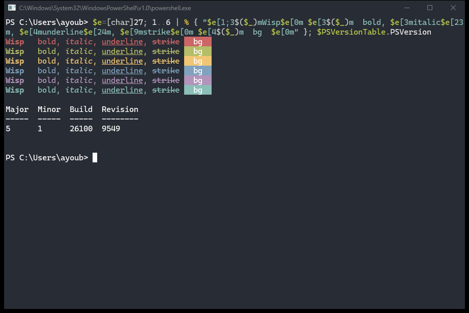

# Wisp devlog

Notes per milestone, with numbers measured on one machine: a laptop with an RTX 3050 and Intel UHD
graphics, Windows 11 build 26300, one 1920x1080 display at 100% scaling.

## M1: a window that runs PowerShell

*2026-10-17*

Wisp opens a window, starts PowerShell in a pseudoconsole, feeds its output through libghostty-vt
and draws the screen with Direct3D 11. Typing works, resizing reflows, and closing the shell closes
the window. Bold and italic use the font's real faces, and the title bar takes the terminal's
background color so the window reads as one surface.

| | |
|---|---|
| Launch to first frame | 122 to 144 ms over six warm launches, measured from process creation |
| Binary | 1.9 MB, one exe, no runtime |
| Tests | 11, including a real ConPTY round trip and an offscreen render checked pixel by pixel |

Input latency and throughput get measured properly in M7. Startup also gets a closer look there. I
haven't profiled it yet, and my guess is that most of the 130 ms is Direct3D device creation on a
hybrid-GPU laptop plus compiling shaders at runtime.

Things that surprised me:

- **The first bytes ConPTY sends are a request.** `ESC[?9001h ESC[?1004h` asks the terminal to
  send keys in "win32-input-mode" and to report focus changes. In that mode every key event travels
  as `ESC[Vk;Sc;Uc;Kd;Cs;Rc_`, the raw Windows key record, and conhost rebuilds it for the program.
  That is how Shift+Enter can reach a console program at all. A test types `echo w32ok` into cmd
  this way and checks the screen.
- **Redirected stdio leaks past the pseudoconsole.** Under `cargo test`, `cmd /c echo` printed to
  the test runner's console instead of into ConPTY. When the parent's stdio is redirected, the child
  inherits those handles unless `STARTF_USESTDHANDLES` is set with null handles.
- **Windows path limits bite the build.** libghostty-vt-sys clones Ghostty deep inside `target/`
  and git fails with "Filename too long". A pinned checkout in `.tools/` fixes it.
- **Testing a GUI without stealing focus.** My first screenshot script typed with SendKeys, which
  goes to whatever window has focus. When Wisp didn't have it, the keystrokes went elsewhere. The
  script now posts messages straight to Wisp's window and captures with `PrintWindow`, so it works
  with the window in the background.
