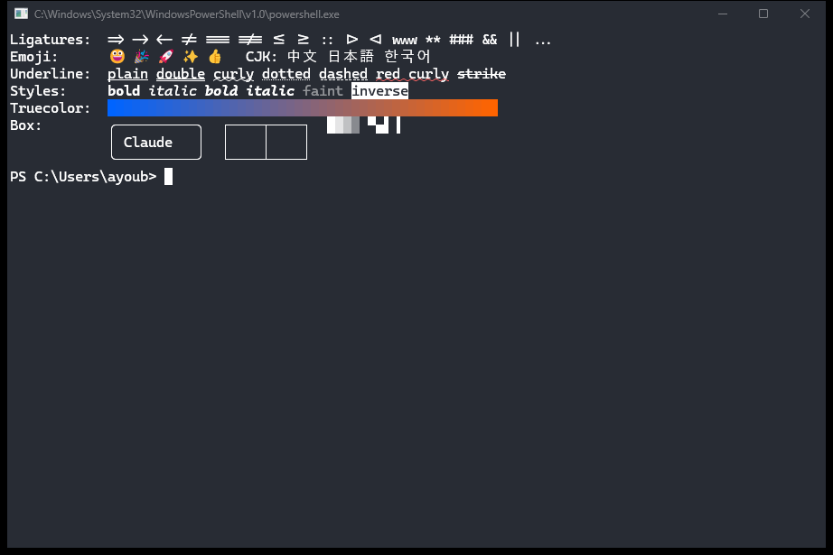
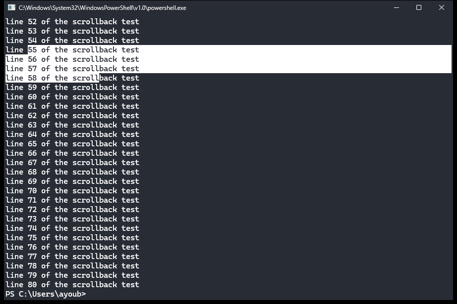
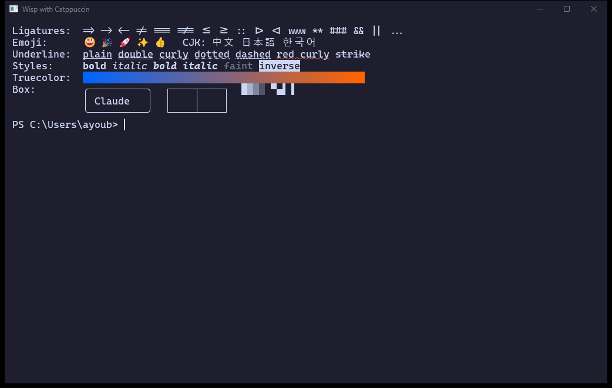

# Wisp devlog

Notes per milestone, with numbers measured on one machine: a laptop with an RTX 3050 and Intel UHD
graphics, Windows 11 build 26300, one 1920x1080 display at 100% scaling.

## M1: a window that runs PowerShell

*2026-10-17*

Wisp opens a window, starts PowerShell in a pseudoconsole, feeds its output through libghostty-vt
and draws the screen with Direct3D 11. Typing works, resizing reflows, and closing the shell closes
the window. Bold and italic use the font's real faces, and the title bar takes the terminal's
background color so the window reads as one surface.

| | |
|---|---|
| Launch to first frame | 122 to 144 ms over six warm launches, measured from process creation |
| Binary | 1.9 MB, one exe, no runtime |
| Tests | 11, including a real ConPTY round trip and an offscreen render checked pixel by pixel |

Input latency and throughput get measured properly in M7. Startup also gets a closer look there. I
haven't profiled it yet, and my guess is that most of the 130 ms is Direct3D device creation on a
hybrid-GPU laptop plus compiling shaders at runtime.

Things that surprised me:

- **The first bytes ConPTY sends are a request.** `ESC[?9001h ESC[?1004h` asks the terminal to
  send keys in "win32-input-mode" and to report focus changes. In that mode every key event travels
  as `ESC[Vk;Sc;Uc;Kd;Cs;Rc_`, the raw Windows key record, and conhost rebuilds it for the program.
  That is how Shift+Enter can reach a console program at all. A test types `echo w32ok` into cmd
  this way and checks the screen.
- **Redirected stdio leaks past the pseudoconsole.** Under `cargo test`, `cmd /c echo` printed to
  the test runner's console instead of into ConPTY. When the parent's stdio is redirected, the child
  inherits those handles unless `STARTF_USESTDHANDLES` is set with null handles.
- **Windows path limits bite the build.** libghostty-vt-sys clones Ghostty deep inside `target/`
  and git fails with "Filename too long". A pinned checkout in `.tools/` fixes it.
- **Testing a GUI without stealing focus.** My first screenshot script typed with SendKeys, which
  goes to whatever window has focus. When Wisp didn't have it, the keystrokes went elsewhere. The
  script now posts messages straight to Wisp's window and captures with `PrintWindow`, so it works
  with the window in the background.

## M2: text that looks right

*2026-10-17*

Cascadia Code's ligatures now form (`=>` becomes an arrow, `!=` becomes `≠`), emoji render in color,
and Chinese, Japanese and Korean text comes from the fonts Windows falls back to. All five underline
styles work, including colored curly underlines. The cursor blinks every 600 ms like Ghostty's and
turns hollow when the window loses focus.

Each row is split into runs of same-style text, and DirectWrite shapes each run. A run also ends at
the cursor, the same as Ghostty's default, so a ligature never forms around the character you're
typing. Characters the font lacks go to the system font fallback. Color emoji come from Segoe UI
Emoji's layered COLR glyphs, which Wisp composites into a second RGBA atlas.

| | |
|---|---|
| Building a full 120x40 frame (CPU) | 2.73 ms before caching shaped runs, 0.41 ms after |
| Launch to first frame | 127 to 189 ms over six warm launches, median about 144 ms |
| Tests | 25, plus an opt-in frame benchmark |

Things that surprised me:

- **Fonts can't draw seamless boxes.** Once a 9.6 px advance rounds to a 10 px cell, `─` leaves a
  gap on every cell and borders look dashed. Claude Code draws its whole UI with `╭─╮│╰─╯`, so
  that was not acceptable. Wisp now draws box drawing, block elements and Powerline arrows itself,
  sized to the exact cell, the way Ghostty does. The rounded corners are quarter circles placed so
  they meet the straight lines on both sides.
- **conhost keeps curly underlines.** ConPTY re-renders the console's buffer instead of passing
  output straight through, so I expected styles conhost doesn't model to disappear. Curly, dotted,
  dashed and colored underlines all survive the round trip on this Windows build.
- **libghostty-vt's cursor doesn't blink by default.** Ghostty's app blinks, so an embedder that
  wants the same behavior has to set the default blink state on the terminal itself.
- **Shaping dominates the frame.** Before the cache, almost all of the 2.7 ms went to DirectWrite
  analyzing and shaping runs that hadn't changed since the last frame.

## M3: mouse and clipboard

*2026-10-17*

Dragging selects text, double-click selects a word and triple-click a line. Right-click copies the
selection, or pastes when nothing is selected, like conhost and Windows Terminal. Ctrl+Shift+C/V
and Ctrl/Shift+Insert copy and paste, Ctrl+Shift+A selects everything, and the wheel and
Shift+PageUp/PageDown scroll through history. Dragging past the top or bottom edge keeps scrolling.
Pasting several lines into a shell that would run them right away asks first, like Ghostty's
clipboard-paste-protection. Programs can set the clipboard with OSC 52.

When a program asks for the mouse, clicks and the wheel go to it instead, and Shift still selects.
The selection logic is libghostty-vt's own gesture state machine, so clicks, drags and repeat-click
timing behave the way they do in Ghostty.

| | |
|---|---|
| Text weight vs. Direct2D | within 2% of Windows' own rendering of the same line, now checked by a test |
| Tests | 30, plus 2 opt-in (a benchmark, and one that overwrites the clipboard) |

Things that surprised me:

- **Mouse tracking survives ConPTY.** I expected conhost to swallow a WSL program's request for
  mouse reports. It doesn't on this Windows build. With `WISP_TRACE_PTY=1` you can watch
  `ESC[?1000h ESC[?1006h` arrive from bash, a click leave as `ESC[<0;10;8M`, and `cat -v` echo it
  back from inside WSL.
- **M2's contrast curve never ran.** The shader constants were bound to the vertex shader only, so
  the pixel shader read zeros and the "light text" correction did nothing. I only noticed while
  checking why text looked heavy, and the honest check turned out to be a reference rather than my
  eyes: the new test renders the same line with Direct2D, which applies DirectWrite's own gamma
  and contrast. Without the curve, Wisp's text had 3.5% less ink than Direct2D's. The strength I
  had picked by eye would have made it 12% heavier. The calibrated value lands within 2%.
- **The clipboard didn't get a live test.** The machine's clipboard held rich browser content that
  couldn't be restored exactly, so copy and paste ran only through unit tests and one opt-in test
  that overwrites the clipboard. Selection, wheel scrolling and mouse reports were checked in the
  real window.

## M4: Ghostty config and themes

*2026-10-17*

Wisp reads Ghostty's config format from `%LOCALAPPDATA%\wisp\config.ghostty`: repeatable keys,
`key =` to reset, `config-file` includes (optional ones with `?`, relative paths, cycles caught),
and every key doubles as a command-line flag. Ctrl+, opens the file and Ctrl+Shift+, applies it to
the running window: colors, fonts, padding and keybinds change without restarting the shell.

All 771 themes Ghostty ships are built into the exe, 366 KB of text. A theme applies before the
config, so colors in the config override it. `theme = light:A,dark:B` follows Windows' dark mode
setting and switches when it changes. Keybinds use Ghostty's syntax and action names, including
`performable:`, and the defaults are Ghostty's Linux set with a few Windows changes.

| | |
|---|---|
| Bundled themes | 771, each parsed by a test with no errors and no ignored keys |
| Live reload | font, size, theme and padding applied on Ctrl+Shift+, in the running window |
| Tests | 43, plus 2 opt-in |

Things that surprised me:

- **A keyboard layout decides what a binding means.** This machine uses a French layout, where the
  digit row types `&é"'(` and digits need Shift. Ghostty's `alt+1` would never fire if triggers
  matched typed characters. Digits and named keys therefore match the physical key, and
  punctuation like `ctrl+comma` matches whichever key types a comma, the same split Ghostty makes.
- **Most of a Mac config is not an error.** A Ghostty config written on macOS is full of
  `macos-*` keys. Treating unknown keys as errors would greet every Mac user with a dialog, so
  only bad values and missing files show one. Unsupported keys go to the log.
- **Ghostty's inline comments aren't comments.** Only a `#` at the start of a line starts one, so
  `background = #282c34` works. I got my own README example wrong at first, writing a comment at
  the end of a line, and the parser would have read it as part of the value.
