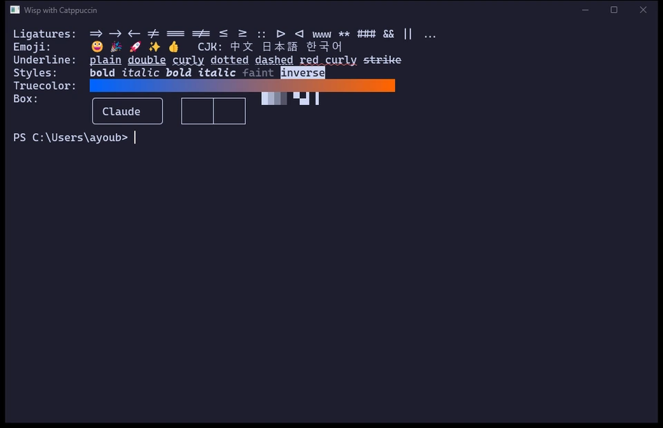

# Wisp

A Windows terminal built on [libghostty-vt](https://github.com/ghostty-org/ghostty), the terminal
emulation core of Ghostty. The goal is for PowerShell, Claude Code and Codex to feel the way they do
in Ghostty on a Mac: fast, sharp text, nothing in the way.

> Working name. [WispTerm](https://github.com/xuzhougeng/wispterm) is a different project, and this
> one gets renamed before any public release.



## Status

Early, but all seven milestones of the first plan are done. PowerShell runs through ConPTY, text
renders with ligatures, color emoji, font fallback and seamless box drawing, the mouse selects,
scrolls and reaches programs that track it, a Ghostty-format config with themes and keybinds
reloads live (`Ctrl+Shift+,`), and the window has tabs in its title bar, Ghostty-style splits, acrylic or Mica, and
fullscreen. A menu opens PowerShell, Command Prompt, Git Bash or any WSL distribution, running on
Microsoft's newer ConPTY when it's bundled.

Single-machine measurements on a mid-range laptop: 110 ms median to first present, 0.8–0.9 ms median key-to-present (13–14 ms p95), and 23 MiB/s in a WSL `cat` test with bundled ConPTY.
[DEVLOG.md](DEVLOG.md) has the numbers per milestone and how each was measured. [PLAN.md](PLAN.md)
has the research and the milestones.

## How it works

Ghostty doesn't ship for Windows, and upstream recommends building Windows terminals on
libghostty-vt instead of porting the app. That library parses VT output and keeps the terminal
state. Wisp adds everything around it in Rust:

- `pty.rs` runs the shell inside a Windows pseudoconsole (ConPTY), preferring the newer conhost
  from Microsoft's ConPTY package when it sits next to `wisp.exe`. `shells.rs` finds the installed
  shells.
- `term.rs` feeds the shell's output to libghostty-vt and answers its queries.
- `input.rs` sends keys in conhost's win32-input-mode, so key combinations like Shift+Enter
  survive the trip through ConPTY.
- `font.rs` shapes text with DirectWrite (ligatures, fallback fonts, color emoji) and rasterizes
  glyphs. `sprite.rs` draws box drawing and block elements to the exact cell size.
- `render.rs` draws each frame as one instanced Direct3D 11 call.
- `mouse.rs` turns clicks into selections with libghostty-vt's gesture state machine, or into
  mouse reports for programs that ask for them. `clipboard.rs` talks to the Windows clipboard.
- `config.rs` and `bindings.rs` read Ghostty-format config files, themes and keybinds.
- `window.rs` owns the Win32 window, its tabs and splits, and paces frames to the display with a
  waitable swap chain. `chrome.rs` lays out the title bar and `layout.rs` the split tree.

Set `WISP_TRACE_PTY=1` to log everything that crosses the pseudoconsole to stderr,
`WISP_TRACE_STARTUP=1` to time each stage of startup, and `WISP_TRACE_LATENCY=1` to time each
keypress until the frame showing its echo is presented. `WISP_INBOX_CONPTY=1` uses the conhost built into Windows
even when the bundled one is there.

## Configuration

Wisp reads Ghostty's config format, so an existing Ghostty config mostly just works. The file lives at
`%LOCALAPPDATA%\wisp\config.ghostty` (or under `%XDG_CONFIG_HOME%` if that's set). Ctrl+, opens it in
an editor and Ctrl+Shift+, reloads it without restarting the shell.

```
font-family = Cascadia Code
# Tried for characters the first font lacks:
font-family = Symbols Nerd Font Mono
font-size = 13
# Ligatures off:
font-feature = -calt
theme = light:Catppuccin Latte,dark:Catppuccin Mocha
cursor-style = bar
window-padding-x = 8
# Ctrl+C copies when something is selected, interrupts otherwise:
keybind = performable:ctrl+c=copy_to_clipboard
```

All 771 themes Ghostty ships are built in, and a `light:...,dark:...` theme follows Windows' dark
mode setting as it changes. Keys Wisp doesn't support yet are logged and skipped, not reported as
errors, since most come from a macOS or Linux config. Any key also works as a flag:
`wisp --theme=Dracula`.

Defaults follow Ghostty, with a few Windows conventions: right-click copies or pastes, F11 and
Alt+Enter toggle fullscreen, and Shift+Home/End are left to PSReadLine.

## Building

You need Windows 11, Rust (MSVC toolchain), the Visual Studio Build Tools and git.

```powershell
. .\scripts\bootstrap.ps1   # fetches Zig 0.15.2, the pinned Ghostty source and ConPTY into .tools\
cargo run --release
cargo test
.\scripts\package.ps1      # dist\wisp-<version>-x64.zip, with ConPTY and the license files
```

`scripts\startup.ps1`, `latency.ps1` and `throughput.ps1` rerun the measurements in the devlog.
They post input to Wisp's own window, so they don't need focus.

## Credits

Wisp exists because of [Ghostty](https://ghostty.org) by Mitchell Hashimoto and the Ghostty
contributors, and because they made its core reusable as libghostty. Wisp is an independent project.
It is not affiliated with or endorsed by the Ghostty project.

The Rust bindings come from [libghostty-rs](https://github.com/uzaaft/libghostty-rs). The ConPTY
lessons in [PLAN.md](PLAN.md) come from the Windows ports that went first: noctty, Wintty,
GhosttyWin32 and WispTerm.

Licensed under MIT. See [LICENSE](LICENSE) and [THIRD-PARTY-NOTICES.md](THIRD-PARTY-NOTICES.md).
